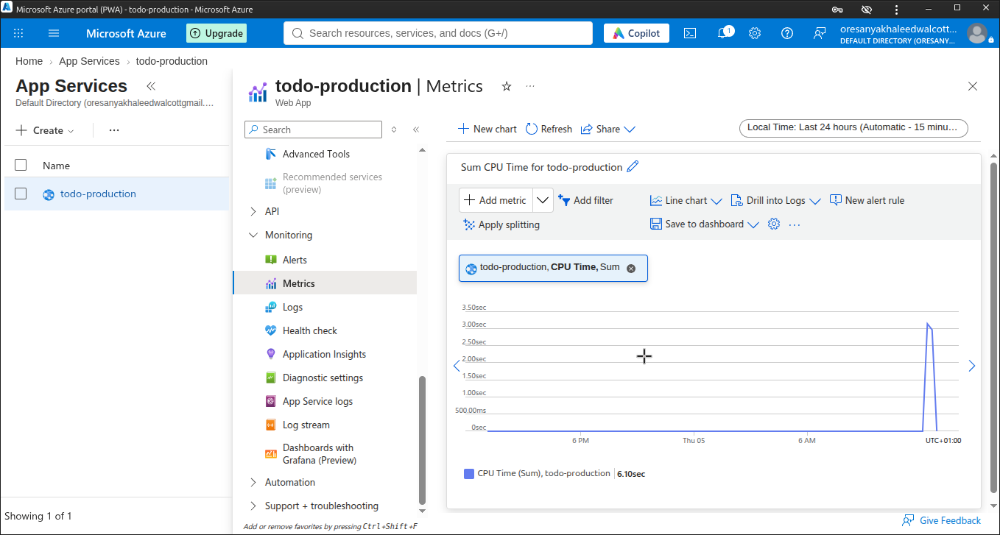
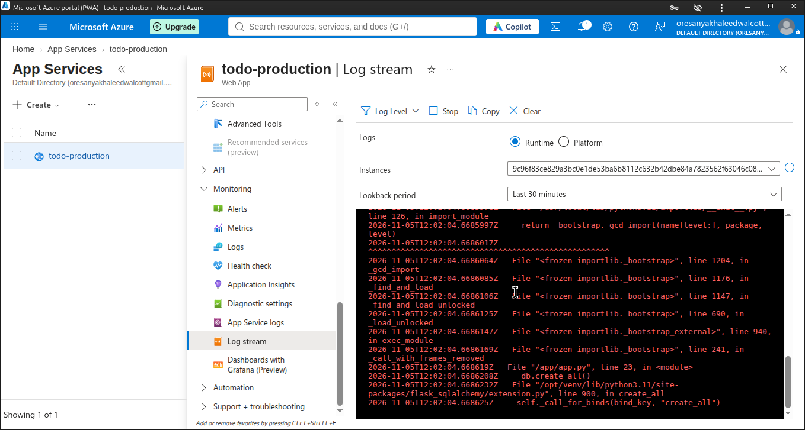

# Containerized To-Do App with CI/CD Deployment to Azure

## Project Overview
This project demonstrates the end-to-end lifecycle of a web application. It covers local development testing, Docker containerization, automated CI/CD via GitHub Actions, deployment to Microsoft Azure App Service, and Active Monitoring.

## Tech Stack
*   **Application:** Python (Flask) with SQLite database.
*   **Containerization:** Docker (Multi-stage build, non-root user).
*   **CI/CD:** GitHub Actions (Builds image, pushes to GHCR, deploys to Azure).
*   **Cloud Hosting:** Azure App Service (Linux Web App, Free Tier).
*   **Registry:** GitHub Container Registry (`ghcr.io`).

---

## Step-by-Step Implementation

### Phase 1: Local Testing & Development
Before containerizing, the application was tested locally in a virtual environment to ensure the developer's code worked.
1. Created and activated a Python virtual environment:
   ```bash
   python3 -m venv venv
   source venv/bin/activate
   ```
2. Installed dependencies: `pip install -r requirements.txt`
3. Ran the Flask app locally on port 8000 to verify the frontend and backend connected successfully.

**Screenshot: Local App Testing**


### Phase 2: Docker Containerization
Created a multi-stage `Dockerfile` to keep the final image lightweight and secure.
*   **Stage 1 (Builder):** Installs build tools (`gcc`), creates a virtual environment (`/opt/venv`), and installs Python dependencies.
*   **Stage 2 (Production):** Copies the completed `venv` from the builder, copies the application code, creates a non-root user (`appuser`), and runs Gunicorn on port 8000.

**Screenshot: Docker Build & Run**


### Phase 3: Azure Infrastructure Setup
1.  **Azure App Service:** Created a Linux Web App on the Free F1 tier, configured to pull a custom Docker container.
2.  **Environment Variables:** Set `WEBSITES_PORT=8000` in Azure App Settings so Azure knows which port Gunicorn is listening on.

**Screenshot: Azure Configuration**


### Phase 4: The CI/CD Pipeline (GitHub Actions)

**Challenges Overcome in the YAML:**
*   **Permissions:** Added `packages: write` to allow GitHub Actions to push to the Container Registry.
*   **Lowercase Tag:** Added a Bash script step to force the repository name and username to lowercase (Docker requirement).
*   **Provenance:** Added `provenance: false` to fix the "unknown blob" push error.
*   **Auth:** Switched from Publish Profile (XML) to Service Principal (JSON) for reliable Azure authentication.


### Phase 5: Active Monitoring
Utilized Azure Monitor to track the application's health and log stream to verify live requests.

**Screenshot: Metrics & Logs**



### Phase 6: The Live Application
The final result: A fully deployed, live application running on Azure.


**Screenshot: Live App**


---

## Note on Managed Databases
For this Capstone prototype, I utilized a containerized SQLite database to ensure a rapid, self-contained deployment. In a production environment, this would be swapped for a Managed Azure Database (like Azure SQL or Cosmos DB) using environment variables for the connection string, ensuring data persistence across container restarts.

## How to Run Locally
```bash
# Build the image
docker build -t todo-capstone-app .

# Run the container
docker run -d -p 8000:8000 --name my-todo-app todo-capstone-app
```
Visit `http://localhost:8000` in your browser.
